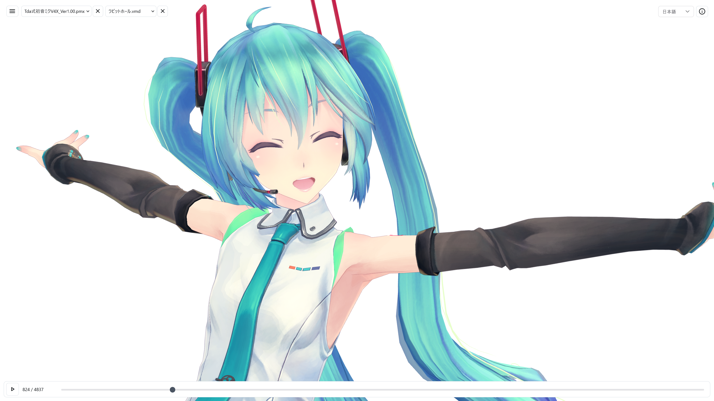

three-mmd-loaderは、Three.jsのシーン上でMMDモデルを読み込み、モーションやポーズを再生するためのTypeScriptライブラリです。PMX・PMDモデルの表示と、VMD・VPDの適用に対応しています。

ブラウザーだけで手元のモデルやモーションを試せる[Live demo](https://three.mmd.yohawing.com/)を公開しています。選択したファイルは端末内で処理され、サーバーへは送信されません。



スクリーンショット使用アセット：モデル[Tda式初音ミク V4X by Tda](https://3d.nicovideo.jp/works/td30681)、モーション[ラビットホール by mobiusP](https://www.nicovideo.jp/watch/sm42576784)。

## クイックスタート

`three`と一緒にnpmからインストールしてください。

```sh
npm install @yohawing/three-mmd-loader three
```

モデルとVMDモーションを読み込み、`model.root`をシーンへ追加して時刻を更新する最小例です。

```ts
import * as THREE from "three";
import { ThreeMmdLoader } from "@yohawing/three-mmd-loader";

const scene = new THREE.Scene();
const loader = new ThreeMmdLoader();
const model = await loader.loadModel("/models/character/model.pmx");
const { animation } = await loader.loadAnimation("/motions/dance.vmd");

model.setAnimation(animation);
scene.add(model.root);
model.update(0);
```

シーンの初期化からレンダーループまでの完全な手順は、[はじめに](/getting-started)を参照してください。

サーバーに置いたモデルは、閲覧者が誰でもダウンロードできます。Webで配信してよいのは、自作のモデルや、規約でWeb配信・再配布が許可されたモデルだけです。詳しくは[試すアセットを用意する](/getting-started/prepare-assets)を参照してください。

## できること

- PMX・PMDモデルの読み込みと表示（BDEF1/2/4・SDEF・QDEFスキニングに対応）
- VMDモーションとVPDポーズの適用、カメラ・ライトトラックの評価
- Toonシェーディング、スフィアマップ、輪郭線（エッジ）、モーフ、セルフシャドウの描画
- Bulletによる剛体・ジョイントの物理演算（任意で接続）
- Web Workerでのアニメーション評価の分離
- WebGPU / TSLパイプラインによる描画（実験的機能）

## 目的から探す

| やりたいこと | 入口 |
| --- | --- |
| モデルを表示して動かす | [はじめに](/getting-started) |
| ファイル選択で読み込む | [アセットとテクスチャ](/guides/assets-and-textures) |
| 髪や衣装を物理で動かす | [物理](/guides/physics) |
| WebGPUで表示する | [WebGPU / TSL](/guides/webgpu) |
| MMDの仕組みやつまずきやすい点を知る | [MMDの仕組み](/concepts/how-mmd-works) |
| 対応形式と制約を調べる | [対応形式](/reference/formats) |
| 動作しない原因を調べる | [トラブルシューティング](/reference/troubleshooting) |

目的別の手順は[実装ガイド](/guides)、モジュール別の入口は[API](/api)にまとめています。

PMMとアクセサリ形式（`.x`、VAC）には構造化解析APIがありますが、シーン全体の一括再生には対応していません。WebGPU / TSLは実験的な機能であり、1.0.0以降もsemverの保証対象外です。導入前に[互換性](/reference/compatibility)を参照してください。

## 関連プロジェクト

PMX解析とアニメーション処理の主要経路にはmmd-animを使用しています。開発にあたり、Babylon-MMD、saba、nanoemを参考にしています。
